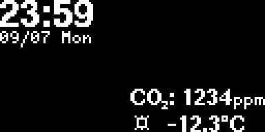
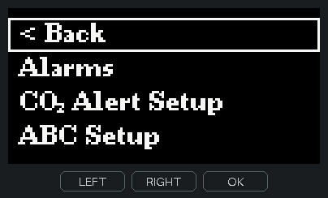
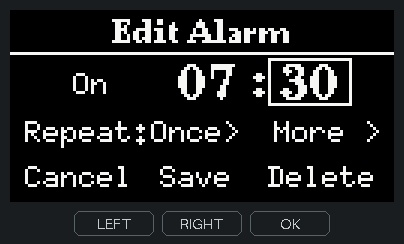
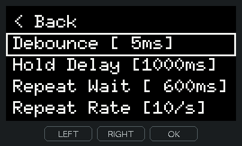
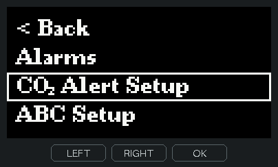
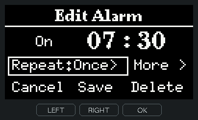
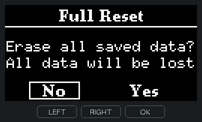
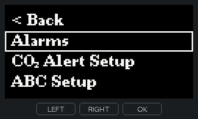
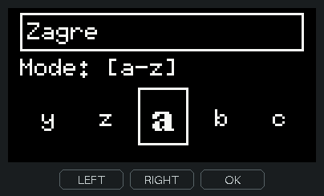

# 세 버튼으로 쓰는 OLED 알람시계

잠에서 깨 시간을 볼 때와, 방이 답답해서 창문을 열까 고민할 때. 두 경우 모두 침대맡 시계를 한 번 보는 것으로 충분했으면 했습니다. ESP32-C3 SuperMini와 128×64 흑백 OLED로 시계와 실내 CO₂ 측정기를 한 기기에 담고, 알람 설정부터 Wi-Fi 비밀번호 입력까지 세 버튼으로 조작하게 만들었습니다.



**시각 아래에는 날짜와 요일을, 실내 CO₂ 농도 아래에는 창문 밖 상황을 놓았습니다.** 몇 시인지 궁금하면 가장 큰 숫자에서 시선을 멈추면 됩니다. 요일까지 궁금할 때만 바로 아래 작은 글씨를 읽습니다. 환기를 고민할 때는 굵게 쓴 CO₂ 수치에서 시작해 그 아래의 기온·강수 확률·미세먼지(PM10)·바람을 살핍니다. CO₂는 방 안의 센서가 측정하고, 바깥 정보는 Wi-Fi로 받아온 도시 날씨를 한 줄씩 돌려 보여줍니다. 원하는 항목을 빨리 보고 싶으면 시계에서 좌우 버튼으로 바로 넘길 수 있습니다.

OLED의 같은 픽셀을 오래 켜 두면 자국이 남을 수 있어 두 묶음은 계속 움직입니다. 그래도 시각을 찾으면 날짜는 늘 그 아래에 있고, CO₂를 찾으면 날씨도 곁에 있습니다.

*화면은 예시 알람과 측정값을 넣고 PC에서 펌웨어의 글꼴·입력 처리·화면 그리기 코드로 재생했습니다. 아래 조작 영상에서 OLED 바깥의 LEFT·RIGHT·OK는 누르는 동안 청록색으로 켜집니다.*

## 내일 쓸 알람은 목록에서 바로 켭니다

매일 쓰는 7시 30분 알람을 오늘만 껐다가 다시 켜는 데 시각과 요일까지 열어 볼 이유는 없습니다. 시계에서 **OK**를 눌러 메뉴를 열고, **좌우**로 `Alarms`에 이동해 **OK**로 들어갑니다. 알람에 테두리가 놓였을 때 **좌우를 함께 누르면** 그 줄의 `[Off]`가 `[On]`으로 바뀝니다. 시각이나 요일을 바꾸고 싶을 때는 같은 줄에서 OK를 누릅니다.



영상에서 `Alarms`를 열 때는 그 줄이 한 프레임 채워지는 동시에 새 목록이 옆에서 들어옵니다. 반면 양쪽을 함께 눌러 켤 때는 목록도 테두리도 제자리에 있고 상태 글자만 바뀝니다. 화면의 움직임만 봐도 방금 다른 곳으로 들어갔는지, 그 자리에서 일이 끝났는지 알 수 있습니다.

세 버튼 중 뒤로 가기 전용 버튼은 없습니다. 그래서 목록형 메뉴에서는 **언제나 첫 항목인 `< Back`**을 찾아 나갈 수 있게 했습니다. 그다음 자리는 자주 찾는 일에 줬습니다. 알람은 메인 메뉴에 들어가자마자 보이고, 입력 설정 복원이나 전체 초기화는 일상적인 탐색 도중 마주칠 가능성이 작도록 해당 목록 끝에 있습니다. 앞에 무엇을 둘지는 사용 빈도로, 실행에 몇 번의 확인을 들일지는 실수했을 때 잃는 것으로 정했습니다.

## 같은 오른쪽 버튼이 무엇을 바꿀지 상자로 보여줍니다

분에 테두리만 있을 때 오른쪽을 누르면 **다음 항목**으로 갑니다. OK를 눌러 같은 상자를 채운 뒤 오른쪽을 누르면 **분 값**이 올라갑니다. 아래 영상에서 `07:30`이 `07:31`로 바뀔 때 움직이는 숫자는 끝자리 하나입니다. 시각 전체를 다시 읽지 않고도 무엇이 바뀌었는지 보입니다.



같은 규칙이 요일을 여러 개 고를 때 특히 유용합니다. 영상 끝에서 **월요일의 채움**은 ‘이미 고른 날’, **화요일의 테두리**는 ‘다음 OK가 적용될 곳’입니다. 커서를 옮겨도 선택 내역이 그대로 보여서 일주일을 한눈에 확인하고 `Done`으로 돌아갈 수 있습니다. 흑백 화면에서 이 두 가지를 구별하는 데 색이나 별도의 안내 줄이 필요하지 않습니다.

## 설정값은 결정을 내릴 자리에서 보여줍니다

**목록에서 바로 바꿀 수 있는 값은 열어 보지 않아도 읽을 수 있습니다.** 예를 들어 `Input Setup`의 `Hold Delay [1000ms]`는 길게 누르기가 인정되기까지 걸리는 시간입니다. 아래처럼 그 줄에서 OK → 오른쪽 → OK를 누르면 1초에서 1.05초로 바뀝니다. 작은 고정폭 글꼴로 다섯 줄을 함께 보여줘서, 바로 아래에서 반복 입력이 시작되는 시간(`Repeat Wait`)도 확인할 수 있습니다. 두 시간을 따로 둔 덕분에 숫자는 꾹 눌러 빨리 넘기면서도 삭제에는 충분한 대기 시간을 둘 수 있습니다.



**메인 메뉴를 훑는 사람은 어느 설정으로 갈지만 결정하면 됩니다.** 그래서 설정 화면으로 이어지는 항목에는 `Setup`이라는 공통 이름을 쓰고, 현재 값은 안에서 보여줍니다. `CO₂ Alert Setup`을 열면 어느 농도(ppm)를 넘을 때 경보가 울리는지 크게 보입니다. `ABC Setup`에서는 센서가 측정 기준점을 자동으로 보정하는 기능을 켜고 끕니다. 맨 위의 `ABC [ON]`이 ‘현재 켜져 있음’을, 그 아래의 `Turn ABC Off now?`가 ‘여기서 확인하면 꺼짐’을 알려줍니다. 바꾸려는 순간에 현재 상태와 결과를 나란히 읽을 수 있습니다.



**알람도 평소에는 시각과 반복 요일만 정하면 됩니다.** 알람마다 다른 기상 습관까지 첫 화면에 펼치면 시각 하나를 고치기도 어려워집니다. 그래서 기본 편집 화면에서 바로 저장할 수 있게 하고, 잠에서 깨는 방법을 바꾸고 싶을 때만 `More`를 열도록 했습니다.



- **조금 더 자고 싶을 때**는 `Snooze`에서 몇 분 뒤에 다시 울릴지, 몇 번까지 미룰지 정합니다.
- **끄고 다시 잠드는 게 걱정될 때**는 `Wake Check`를 켭니다. 영상의 설정이라면 알람을 마친 **1분 뒤** 기상 여부를 다시 묻고, 그 아래 `Check Limit`에 정한 **60초 동안** 응답이 없으면 알람이 다시 울립니다.
- **일어나서 불을 켜야 알람을 마치고 싶을 때**는 `Light`에서 그 방의 불을 켠 상태를 먼저 측정한 뒤 밝기 미션을 고릅니다. 방마다 전등과 센서 위치가 달라 기준을 직접 익히게 했습니다. 버튼 순서를 기억하는 미션과 조합할 수도 있습니다.

## 실수로 누른 버튼을 놓을 시간이 있어야 합니다

저장된 Wi-Fi를 지우거나 설정을 기본값으로 돌릴 때는 OK를 길게 누릅니다. **지금 누른 항목의 테두리가 왼쪽부터 차오르므로** 무엇에 적용되는지, 손을 얼마나 더 대고 있어야 하는지 함께 보입니다. 영상에서 첫 번째로 `Yes`를 누르다 놓는 순간을 보면 채움이 사라지고 같은 질문에 머뭅니다.



전체 초기화는 알람과 Wi-Fi 등 저장 데이터를 한꺼번에 지웁니다. 첫 `Yes`를 3초 채워도 다음 질문은 다시 `No`에서 시작합니다. 손을 떼고 두 번째 `Yes`로 옮겨 다시 3초를 채워야 실행됩니다. 일반 길게 누르기를 짧게 설정한 사람에게도 이 두 번의 3초는 같습니다. 끝에 보이는 스피너는 Wi-Fi 검색처럼 기다리는 다른 화면에서도 같은 위치에 돌아갑니다. 처리 중인지 확인하려고 다시 누를 필요가 없습니다.

## 메뉴를 닫는 걸 잊었을 때와 아직 읽고 있을 때

설정하다 자리를 뜨면 고정된 글자가 OLED에 계속 남습니다. 그래서 마지막 조작에서 **5분**이 지나면 움직이는 시계 화면으로 돌아갑니다. 반대로 사용자가 설정을 읽으며 생각하는 중일 수도 있습니다. 마지막 **30초**에는 `Close Menu`와 남은 초를 먼저 보여줍니다. 계속 쓸 때는 하던 대로 조작하면 됩니다. 별도 확인창을 닫는 단계 없이 경고가 사라지고 대기 시간이 다시 시작됩니다.



*영상은 경고가 나오기 직전부터 시작합니다. 오른쪽을 누른 뒤 테두리가 Alarms에서 CO₂ Alert Setup으로 이동합니다.*

## 어두운 방에서 화면을 깨우는 첫 누름

침대맡에서는 화면의 빛 자체가 방해가 됩니다. 조도 센서가 어둠을 감지하고 1분간 조작이 없으면 OLED를 끕니다. 깨어서 누르는 첫 버튼은 손을 뗄 때까지 화면을 깨우는 데만 씁니다. 화면을 보기도 전에 메뉴에 들어가거나 알람을 꺼 버리는 일을 막기 위해서입니다. 알람이 울리거나 기상 미션을 수행하는 동안에는 필요한 화면을 볼 수 있습니다.

## 움직이는 시계가 모서리까지 쓰는 방법

시계가 화면 끝에 다다랐는데도 글자 바깥에 빈 폭이 남으면 가장자리 픽셀은 계속 놀게 됩니다. 이 시계는 **실제로 켜진 픽셀의 상하좌우 끝**을 기준으로 이동 범위를 잡습니다. 날씨 줄이 더 긴 내용으로 바뀔 때는 새 폭이 들어갈 자리가 생긴 뒤 교체해서 모서리에서 숫자가 잘리지 않게 합니다.

`Motion Setup`의 `Organic` 모드에서는 시계와 환경 정보가 서로 길을 내주며 자리를 바꿉니다. 둘이 계속 같은 곳에서 마주치면 화면을 넓게 움직여도 일부 픽셀만 오래 켜지기 때문입니다. `Coverage`를 높이면 덜 켜진 곳을 경로 선택에 더 반영하고, `Jerk Limit`을 높이면 가속도가 급하게 변하는 정도를 줄입니다. 움직임의 속도도 따로 맞출 수 있습니다.

같은 시작 조건과 속도(초당 6픽셀)로 20분씩 시뮬레이션한 결과, `Coverage` 0과 100에서 한 번이라도 사용한 화면 면적은 **모두 약 99.6%**였습니다. 차이는 *얼마나 오래 켜졌느냐*에 있었습니다. 가장 오래 켜진 픽셀의 점등 시간은 전체 픽셀 평균의 **2.75배에서 2.57배**로 줄었습니다. 이 수치는 해당 경로의 점등 시간 분포를 비교한 결과입니다.

## 하드웨어와 빌드

| 부품 | ESP32-C3 SuperMini 연결 |
|---|---|
| SSD1306 OLED, 128×64, I²C | SDA GPIO4 / SCL GPIO5 |
| MH-Z19 계열 CO₂ 센서, UART 9600 | ESP RX GPIO7 ← 센서 TX / ESP TX GPIO6 → 센서 RX |
| 조도 센서 / 부저 | ADC GPIO0 / 출력 GPIO8 |
| 왼쪽 / 오른쪽 / 확인 버튼 | GPIO3 / GPIO1 / GPIO10, 내부 풀업·눌림 LOW |

1. `git clone https://github.com/ballsun1003/esp32c3-oled-alarm-clock.git co2`로 받아 Arduino IDE에서 [co2.ino](co2.ino)를 엽니다. 스케치와 폴더 이름을 맞추기 위해 `co2`로 받습니다.
2. 검증에 사용한 조합은 **ESP32 코어 3.3.11**, **U8g2 2.36.19**, **ESP32Time 2.0.6**, **ArduinoJson 7.4.3**입니다. 보드는 **ESP32C3 Dev Module**, 파티션은 **No OTA (2MB APP/2MB SPIFFS)**를 선택합니다.
3. Arduino IDE에서 컴파일하거나 Windows에서 [펌웨어 빌드 스크립트](tools/test_firmware.ps1)를 실행합니다. 이 구성에서 기록한 앱 크기는 **1,246,251 / 2,097,152바이트(59%)**, 정적 RAM은 **81,536바이트**입니다.
4. 기기에서 `WiFi Setup`으로 네트워크에 연결하면 인터넷 시간 서버와 시각을 맞춥니다. `Location Setup`에서 도시를 고르면 그곳의 날씨와 미세먼지를 받아옵니다.

<details>
<summary>세 버튼으로 도시 이름을 입력하는 모습</summary>

전체 자판을 128픽셀 안에 줄여 넣으면 누를 글자를 찾기 어렵습니다. 좌우 후보를 작게 보여주고 가운데 글자만 확대해 OK로 입력합니다. 아래는 도시 이름 `Zagreb`의 마지막 `b`를 고르는 장면입니다. 작은 글자가 상자 경계를 지나며 커지고, 입력되는 순간 상자가 한 프레임 반짝입니다. 양쪽 버튼을 함께 누르면 대소문자·숫자·기호·명령을 전환할 수 있습니다.



</details>

## 코드와 검증

| 확인할 동작 | 구현 |
|---|---|
| 버튼 접점 떨림을 걸러내고 짧은 누름·반복·길게 누르기 구분 | [oled_input.h](oled_input.h) |
| 포커스 이동, 메뉴 전환, 바뀐 숫자와 키보드 글자만 움직이기 | [oled_ui.h](oled_ui.h) · [oled_widgets.h](oled_widgets.h) |
| 실제 글자 경계 측정, 두 묶음의 경로와 점등 시간 계산 | [oled_motion.h](oled_motion.h) · [oled_path.h](oled_path.h) |
| 메뉴의 입력 처리, 최대 100개 알람, 센서 측정·보정과 네트워크 | [co2.ino](co2.ino) |

PC에서는 펌웨어와 같은 U8g2 글꼴로 화면을 그려 테두리와 글자 사이의 빈 픽셀, 숫자를 바꿨을 때 그대로여야 하는 자리, 길게 누르다 놓았을 때의 취소를 검사합니다. 이동 검사는 날씨 줄의 폭을 바꾸며 두 묶음이 겹치거나 화면 밖으로 나가는지도 확인합니다. [검증 시나리오](tests/)

<details>
<summary>Windows에서 검사와 README 영상 재현하기</summary>

Visual Studio 2022 C++ Build Tools와 Node.js가 필요합니다. U8g2가 기본 Arduino 라이브러리 폴더 밖에 있다면 `U8G2_SOURCE`를 해당 라이브러리의 `src/clib` 경로로 지정합니다. 저장소 루트에서 `tools\test_input.cmd`는 버튼, `tools\test_alarm.cmd`는 알람, `tools\test_native.cmd`는 움직임, `tools\test_display.cmd`는 화면을 각각 검사합니다.

영상도 다시 만들려면 Python과 Pillow 10.1 이상을 설치한 뒤 PowerShell에서 실행합니다. [조작 시나리오](tests/readme_demo.h) · [GIF 생성 코드](tools/render_readme.py)

```powershell
$env:CO2_CAPTURE_DEMO = '1'
.\tools\test_display.cmd
py -3 tools/render_readme.py
```

</details>
