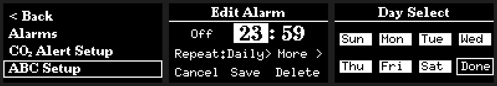
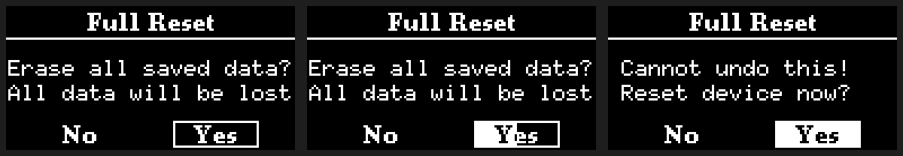

# 세 버튼으로 쓰는 OLED 알람시계

ESP32-C3 SuperMini와 128×64 흑백 OLED로 만든 침대맡 시계입니다. 시각과 날짜, 실내 CO₂ 농도, 날씨를 보여주고, 아침에는 요일별 알람과 선택형 기상 미션을 실행합니다.

*아래 화면들은 실기 촬영 대신 펌웨어의 글꼴과 그리기 코드로 PC에서 렌더링했습니다. 위 영상은 예시 측정값을 넣고 실제 이동 알고리즘을 실행한 12초 구간입니다.*

## 알람 하나를 켜는 데 몇 번 눌러야 할까

내일 쓸 알람을 다시 켤 때, 이미 맞춰 둔 시각이나 요일까지 확인해야 할 이유는 없습니다. 그래서 알람 목록에서 원하는 항목에 커서를 놓고 **양쪽 버튼을 함께 누르면 그 자리에서 켜고 끌 수 있게** 했습니다. 시각을 바꾸고 싶을 때만 확인 버튼으로 편집 화면에 들어갑니다.

반대로 **전체 초기화에는 두 번의 확인**을 남겼습니다. 한 번의 실수로 저장된 알람과 Wi-Fi 정보를 잃는다면, 버튼 한 번을 아끼는 것보다 손해가 큽니다. 화면 깊이를 정할 때의 기준은 일률적인 클릭 수가 아니라 *그 행동을 얼마나 자주 하는지, 잘못했을 때 되돌릴 수 있는지*였습니다.

### 설명을 읽지 않아도 같은 방식으로

- **테두리는 지금 있는 곳, 채움은 선택한 것.** 왼쪽 화면의 테두리는 목록에서 커서가 있는 위치입니다. 가운데에서 시를 편집하면 같은 크기의 상자가 채워집니다. 오른쪽 요일 선택에서는 선택한 요일을 채운 채 테두리 커서만 옮길 수 있어, 다음 항목으로 가도 이전 선택을 잊지 않습니다.
- **목록의 첫 줄은 항상 `< Back`.** 메인 메뉴는 그 아래에 자주 쓸 Alarms를, 맨 아래에 Full Reset을 둡니다. Motion과 Input의 기본값 복원도 각 목록 끝에 있습니다. 작은 설정 글꼴을 쓸 때는 한 화면에 다섯 항목을 보여주고, 테두리와 글자 사이에는 빈 픽셀을 남겼습니다.
- **들어갈 곳과 바꿀 값을 구분.** 목록에서 바로 조절하는 값은 `Hold Delay [1000ms]`처럼 대괄호에 넣습니다. 반면 `CO₂ Alert Setup`과 `ABC Setup`에는 상태를 덧붙이지 않고, 그 화면에 들어갔을 때 보여줍니다. 알람 편집도 시각과 반복은 앞에 두고, 스누즈·기상 재확인·조도 학습은 `More` 아래에 모았습니다.
- **글꼴과 이름도 길 안내에 사용.** 시각은 큰 숫자로, 촘촘한 설정 목록은 폭이 일정한 작은 글꼴로 그립니다. 같은 종류의 설정은 `Setup`으로 이름을 맞췄습니다. 화려한 제목이나 상시 버튼 힌트가 정보 한 줄을 밀어내지 않게 했습니다.

### 누르는 동안에도 결과를 예측할 수 있게

짧은 확인은 진입·선택·편집에, 양쪽 동시 누름은 알람 즉시 토글이나 키보드 모드 변경처럼 현재 화면에서 끝낼 수 있는 일에 씁니다. 저장된 Wi-Fi 삭제나 설정 복원처럼 실수 비용이 큰 동작에는 길게 누르기를 사용합니다.

길게 누르면 **포커스 상자 자체가 왼쪽부터 찹니다.** 별도의 진행 창을 띄우지 않아 무엇에 적용되는지 계속 볼 수 있고, 중간에 놓으면 취소됩니다. Full Reset의 첫 Yes를 3초 유지하면 두 번째 화면에서 **No가 선택된 상태**로 시작합니다. 다시 Yes를 골라 별도로 3초를 채워야 초기화됩니다.

일반 길게 누르기 시간, 좌우 버튼을 누른 뒤 반복이 시작될 때까지의 대기, 반복 속도는 따로 조절합니다. 숫자를 빨리 넘기고 싶은 사람이 삭제까지 빨리 실행하도록 강제할 필요는 없기 때문입니다. Full Reset의 3초는 이 설정에 영향을 받지 않습니다.

### 움직임마다 전달할 정보 하나

숫자가 `12:34 → 12:35`로 바뀌면 마지막 자리만 짧게 움직입니다. 그대로인 시·분의 다른 자리와 구분 기호는 눈으로 다시 좇을 필요가 없습니다. 키보드에서는 작은 후보 글자가 가운데 상자 안으로 들어오며 큰 글자로 보이고, 입력이 받아들여지면 상자가 한 프레임 반짝입니다.

화면 이동 효과는 실제로 다른 메뉴로 들어갈 때 씁니다. 같은 Wi-Fi 화면에서 스캔·연결 상태만 달라지면 내용만 갱신합니다. 기다려야 하는 전체 화면에는 같은 위치에서 도는 스피너를 둬서, 아직 작업 중이라는 사실을 버튼을 다시 눌러 확인하지 않아도 됩니다.

## 밤에 시계가 사용자에게 요구하지 않아야 하는 일

**메뉴를 닫아 둘 필요가 없습니다.** 조작 없이 5분이 지나면 시계로 돌아가 고정 메뉴가 계속 켜져 있지 않게 합니다. **자기 전에 화면을 직접 끌 필요도 없습니다.** 주위가 어둡고 1분 동안 입력이 없으면 OLED를 끕니다. 화면을 깨운 첫 누름은 깨우는 데만 써서 보지 못한 메뉴까지 선택하지 않습니다. 알람이나 기상 미션처럼 화면이 필요한 순간은 예외입니다.

시계로 돌아간 뒤에도 같은 픽셀만 오래 켜지지 않게 했습니다. 시계와 환경 정보의 충돌 영역은 글꼴의 명목상 박스 대신 **실제로 켜진 가장 바깥 픽셀**로 잡습니다. 날씨 정보가 바뀌어 폭이 커지면 다음 내용이 들어갈 공간도 고려합니다. Organic 모드에서는 두 객체가 함께 이동 경로를 정하고, 누적 점등 시간이 적은 영역을 더 쓰도록 합니다. 사용자는 속도·커버리지·가속도 변화 제한(Jerk Limit)을 조절할 수 있습니다.

같은 조건의 20분 모의 실행에서 Coverage를 0에서 100으로 높이자 픽셀별 점등 시간의 변동계수는 **0.594 → 0.490**으로 줄었습니다(6px/s, 같은 시드). 이는 해당 조건에서 점등 시간이 더 고르게 분포했다는 뜻이며, OLED 수명을 측정한 값은 아닙니다.

## 알람과 환경 기능

- **알람:** 최대 100개, 일회·요일 반복, 알람별 스누즈와 기상 재확인. 재확인은 ‘몇 분 뒤 다시 물을지’와 ‘물은 뒤 응답을 몇 초 기다릴지’를 별도로 설정합니다.
- **기상 미션:** 버튼 순서 기억, 방 밝기 확인, 둘의 조합. 조도 기준은 알람을 설정할 때 그 방에서 직접 학습합니다. 미션 없이 평범한 알람으로도 쓸 수 있습니다.
- **환경:** MH-Z19 계열 센서의 CO₂ 측정·임계값 경보, 자동 기준선 보정(ABC) 설정, 수동 보정. Wi-Fi에 연결하면 NTP로 시간을 맞추고, 선택한 도시의 기온·강수 확률·바람·PM10을 순환 표시합니다.

## 하드웨어와 빌드

| 부품 | ESP32-C3 SuperMini 연결 |
|---|---|
| SSD1306 OLED, 128×64, I²C | SDA GPIO4 / SCL GPIO5 |
| MH-Z19 계열 CO₂ 센서, UART 9600 | ESP RX GPIO7 ← 센서 TX / ESP TX GPIO6 → 센서 RX |
| 조도 센서 / 부저 | ADC GPIO0 / 출력 GPIO8 |
| 왼쪽 / 오른쪽 / 확인 버튼 | GPIO3 / GPIO1 / GPIO10, 내부 풀업·눌림 LOW |

1. `git clone https://github.com/ballsun1003/esp32c3-oled-alarm-clock.git co2`로 받아 Arduino IDE에서 [co2.ino](co2.ino)를 엽니다. 폴더와 스케치 이름이 같아야 합니다.
2. ESP32 보드 패키지와 **U8g2, ESP32Time, ArduinoJson**을 설치합니다. 빌드 검증 조합은 ESP32 코어 3.3.11, U8g2 2.36.19, ESP32Time 2.0.6, ArduinoJson 7.4.3입니다.
3. 보드는 **ESP32C3 Dev Module**, 파티션은 **No OTA (2MB APP/2MB SPIFFS)**로 선택하고 컴파일합니다. 확인된 앱 크기는 **1,246,251 / 2,097,152바이트(59%)**, 정적 RAM은 81,536바이트입니다. Wi-Fi와 도시는 기기 메뉴에서 설정합니다.

Windows에서는 [펌웨어 빌드 스크립트](tools/test_firmware.ps1)를 실행해 같은 파티션으로 컴파일할 수 있습니다. 빌드와 업로드는 별개입니다.

## 검증과 코드 읽기

PC 검사는 설치된 U8g2로 펌웨어의 화면 그리기 코드를 실행합니다. 버튼 바운스, 알람이 겹친 경우, 숫자가 바뀌지 않은 자리의 픽셀, 글자와 테두리 사이 여백, 길게 누르기 중도 취소를 검사합니다. 이동 경로는 별도로 시뮬레이션해 화면 밖으로 나가거나 두 객체가 겹치는지 확인합니다.

| 관심 있는 부분 | 시작할 파일 |
|---|---|
| 버튼 판정, 반복과 길게 누르기 | [oled_input.h](oled_input.h) |
| 포커스·페이지 전환, 숫자·키보드·부분 화면 전송 | [oled_ui.h](oled_ui.h) · [oled_widgets.h](oled_widgets.h) |
| 픽셀 점등 기록과 두 객체의 경로 | [oled_motion.h](oled_motion.h) · [oled_path.h](oled_path.h) |
| 메뉴·알람·센서·네트워크 연결 | [co2.ino](co2.ino) |
| 검증 시나리오 | [tests](tests/) |

Windows의 Visual Studio 2022 C++ Build Tools, Node.js, U8g2 소스가 있으면 저장소 루트에서 `tools\test_display.cmd`, `tools\test_alarm.cmd`, `tools\test_input.cmd`, `tools\test_native.cmd`로 재현할 수 있습니다. U8g2가 기본 Arduino 라이브러리 폴더에 없다면 `U8G2_SOURCE`를 해당 라이브러리의 `src/clib` 경로로 지정합니다.
