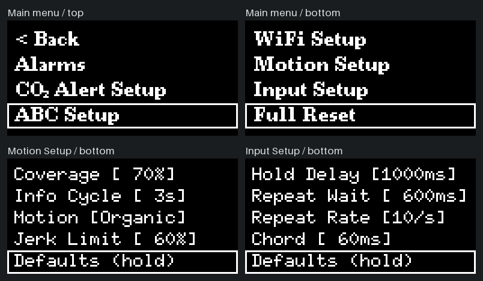

# 세 버튼으로 쓰는 CO₂ 측정기 겸 알람시계

실내 이산화탄소(CO₂) 측정기를 만들다가 다른 기능도 얹어 보면 어떨까 싶었습니다. 그렇게 시계와 날씨, 알람을 하나씩 더했습니다. 지금은 방 안의 CO₂ 농도를 읽고, 바깥 날씨를 확인하고, 요일마다 다른 알람을 맞출 수 있습니다. ESP32-C3 SuperMini에 128×64픽셀 흑백 OLED를 연결했고, 조작에는 왼쪽·오른쪽·확인(OK) 버튼 세 개를 씁니다.

이 크기에서는 버튼 설명이 한 줄 늘면 정보를 보여 줄 자리도 한 줄 줄어듭니다. 평소에는 메뉴를 열지 않고 시각과 CO₂ 농도를 읽을 수 있게 하고, 설정에서는 한 화면에서 익힌 버튼과 표시를 다음 화면에서도 같은 뜻으로 썼습니다.


**시각**은 멀리서도 먼저 읽히도록 가장 큰 숫자로 쓰고, 함께 확인할 **날짜와 요일**은 그 바로 아래에 작은 글씨로 붙였습니다.

**환기할 때**는 방 안에 CO₂가 얼마나 쌓였는지와 지금 창문을 열기에 바깥 상황이 어떤지를 함께 봅니다. 실내 센서가 측정한 **CO₂ 농도**를 굵게 표시하고, 그 아래 한 줄에는 Wi-Fi로 받은 도시의 기온·강수 확률·미세먼지(PM10)·바람을 번갈아 보여줍니다. 원하는 항목은 좌우 버튼으로 바로 넘길 수 있습니다.

영상에서 두 묶음이 떠다니는 이유는 오래 켜 두는 시계에서 같은 픽셀만 먼저 닳아 자국이 남는 **번인**을 줄이기 위해서입니다. 묶음째로 움직이기 때문에 위치가 달라져도 시각 바로 아래에서 날짜를, CO₂ 바로 아래에서 날씨를 찾을 수 있습니다. [픽셀별 점등 시간 비교](#oled-번인을-줄이는-두-가지-방법)

*시계 영상은 예시 측정값으로 실제 이동 알고리즘을 12초간 실행한 모습입니다. 아래 화면도 펌웨어의 입력 처리와 그리기 코드로 PC에서 재현했습니다. 조작 영상에서 OLED 아래의 LEFT·RIGHT·OK는 누를 때 켜집니다.*

## 메뉴를 배치한 기준

시계에서 OK를 누르면 메인 메뉴가 열립니다. 좌우 버튼으로 항목을 옮겨 다니고 OK로 고릅니다. 열 항목 중 한 화면에 보이는 건 네 줄이라 순서에 따라 필요한 조작 횟수가 달라집니다. 첫 줄은 뒤로 가는 데 쓰고, 그 아래에는 자주 찾는 기능을, 아래쪽에는 드물게 쓰거나 실행 결과를 되돌리기 어려운 기능을 뒀습니다.

| 메인 메뉴의 항목 (위에서 아래 순서) | 그 자리에 둔 이유 |
|---|---|
| `< Back` | 뒤로 가기 전용 버튼이 없어 **모든 목록의 첫 항목**을 뒤로 가기로 통일했습니다. 처음 연 설정에서도 맨 위로 가면 한 단계 돌아갈 수 있습니다. |
| `Alarms` | 한 번 맞춰 둔 알람도 오늘 켜거나 끌 일은 자주 생깁니다. 목록 맨 위에서 한 칸만 움직이면 알람에 닿습니다. |
| `CO₂ Alert Setup` · `ABC Setup` · `Manual Calibration` | 경보가 울릴 농도, 센서의 자동 보정, 수동 보정을 이웃한 항목으로 묶었습니다. CO₂ 측정에 관한 일을 할 때 같은 구간에서 찾을 수 있습니다. |
| `Location Setup` · `WiFi Setup` · `Motion Setup` · `Input Setup` | 도시와 네트워크는 한 번 지정하면 계속 쓰고, 화면 움직임과 버튼 감도도 취향에 맞춰 두면 자주 손댈 일이 적습니다. 알람이나 CO₂ 경보를 찾는 경로 뒤에 모았습니다. |
| `Full Reset` | 저장한 알람과 Wi-Fi 정보를 모두 지우는 기능입니다. 일상적인 조작 중에 실수로 고를 가능성을 줄이려고 맨 아래에 뒀습니다. |



같은 원칙으로 `Motion Setup`과 `Input Setup`에서도 평소에 조절하는 값을 먼저 보여줍니다. 각 설정만 기본값으로 돌리는 `Defaults (hold)`는 두 목록 모두 마지막 항목입니다. 두 설정과 알람의 `More`에서는 짧은 이름과 숫자를 작은 고정폭 글꼴로 써서 **다섯 항목**을 한눈에 비교할 수 있게 했습니다. 글자와 테두리 사이에는 빈 픽셀을 남겼습니다. 흑백 화면에서 두 선이 붙으면 글자 획인지 커서인지 구별하기 어렵기 때문입니다.

## 세 버튼으로 알람 켜기, 시각 바꾸기, 요일 고르기

**저장된 알람을 다시 켤 때** 필요한 정보는 목록 한 줄에 다 있습니다. 아래 영상에서는 시계의 메인 메뉴에서 `Alarms`를 열고, `07:30 Daily [Off]`에 테두리를 옮겨 **좌우를 함께** 누릅니다. 같은 줄에서 `[On]`을 확인하면 끝입니다. 이미 맞춰 놓은 시각과 요일을 다시 열고 저장하는 절차를 덜었습니다. 시각을 바꾸려면 그 줄에서 **OK**를 짧게 누릅니다.


영상에서 `Alarms`를 열 때는 누른 줄이 한 프레임 반짝이는 순간 새 목록이 옆에서 들어옵니다. 같은 목록에서 알람을 켤 때는 커서가 그 줄에 머물고 상태 글자만 바뀝니다. 이 차이로 사용자는 방금 하위 메뉴를 열었는지, 그 자리에서 조작을 마쳤는지 구별할 수 있습니다.

**값을 편집할 때**는 오른쪽 버튼의 뜻이 달라집니다. 분에 테두리만 있을 때 누르면 다음 항목으로 이동합니다. OK를 눌러 같은 크기의 상자가 채워진 뒤 누르면 분 값이 올라갑니다. `07:30`에서 `07:31`로 넘어갈 때도 끝자리만 위아래로 움직입니다. 달라진 자리에만 시선이 가도록 시·분의 나머지 숫자와 구분 기호는 고정했습니다.


영상 끝에서 **월요일은 채워져 있고 화요일에는 테두리만 있습니다.** 월요일은 이미 고른 날이고, 화요일은 다음 OK가 적용될 곳입니다. 선택과 커서를 따로 그리면 여러 요일을 고르다가도 일주일 전체를 확인할 수 있습니다. 이 구분을 다른 메뉴에도 적용해 좁은 화면에 버튼 설명을 늘 띄워 둘 필요를 줄였습니다.

### 알람마다 다른 기상 습관은 `More`에서

평범한 알람 하나를 맞추는 데 미션이나 스누즈 설정을 지나가야 한다면 기능을 늘린 만큼 조작도 길어집니다. 시각·반복 요일·저장은 첫 편집 화면에 같이 두고, 일어나는 방법을 다르게 정하고 싶을 때만 `More`를 열게 했습니다. 일회 알람과 요일 반복 알람을 합해 최대 100개까지 저장할 수 있습니다.


- **조금 더 자려면** `Snooze`에서 다시 울릴 간격과 미룰 수 있는 횟수를 정합니다. 스누즈를 허용한 알람이 울릴 때는 좌우를 함께 눌러 미룹니다.
- **알람을 끄고 도로 잠드는 게 걱정된다면** `Wake Check`로 몇 분 뒤 기상 여부를 다시 물을지 정합니다. 바로 아래 `Check Limit`은 그 질문에 답할 시간입니다. 영상처럼 1분과 60초로 두면 알람을 마친 1분 뒤에 다시 묻고, 거기서 60초 동안 응답이 없으면 알람이 다시 울립니다. 응답 시간은 10~180초 범위에서 고를 수 있습니다.
- **방에 불을 켜야 알람을 마치고 싶다면** 먼저 불을 켠 채 `Light`에서 밝기를 재고 `Mission`을 `Light`로 고릅니다. 전등과 센서 위치가 집마다 달라 그 방에서 직접 잰 밝기를 미션의 기준으로 씁니다. `Keys`는 화면에 나온 좌우 순서를 기억해 버튼으로 따라 누르는 미션이고, `Light+Keys`로 두 미션을 함께 쓸 수도 있습니다.

## 메뉴를 열기 전에 보여 줄 정보와 들어가서 보여 줄 정보

`Input Setup`에서는 **그 줄에서 바꿀 값**을 대괄호에 표시합니다. `Hold Delay [1000ms]`는 OK를 1초 동안 눌러야 길게 누른 것으로 인식한다는 뜻입니다. 바꾸고 싶으면 OK를 짧게 눌러 편집을 시작합니다. 영상에서는 오른쪽을 한 번 눌러 1050ms로 바꾼 뒤 OK로 편집을 마칩니다. 별도 화면을 열지 않아 값을 고치는 동안에도 이웃한 설정을 함께 볼 수 있습니다.


길게 눌러 삭제할 때의 대기 시간(`Hold Delay`, 기본 1초, 0.3~3초)과 숫자를 계속 넘기기 시작할 때까지의 시간(`Repeat Wait`)은 따로 정합니다. 숫자를 빨리 넘기고 싶다는 이유로 삭제까지 빨라지면 곤란하기 때문입니다. 반복 속도(`Repeat Rate`), 스위치가 한 번 눌렸는데 여러 번으로 읽히는 현상을 거르는 시간(`Debounce`), 좌우를 함께 누를 때 두 입력 사이에 주는 여유(`Chord`)도 조절할 수 있습니다.

**메인 메뉴**에서 결정할 일은 어느 기능으로 갈지입니다. 센서 설정으로 들어가는 항목에는 `CO₂ Alert Setup`, `ABC Setup`처럼 공통으로 `Setup`을 붙이고 이름만 보여줍니다. 현재 값은 실제로 판단할 자리에 뒀습니다. CO₂ 경보를 열면 경보가 울릴 기준 농도가 단위(ppm)와 함께 크게 보입니다. 센서가 기준점을 스스로 보정하는 기능(ABC)을 열면 맨 위에 현재 상태인 `ABC [ON]`이, 바로 아래에는 `Turn ABC Off now?`가 보입니다. Yes를 고르기 전에 무엇이 어떻게 달라질지 한 화면에서 읽을 수 있습니다.


## 삭제를 실행하기 전과 결과를 기다리는 동안

저장한 Wi-Fi 정보를 실수로 지우면 비밀번호를 세 버튼으로 다시 입력해야 합니다. 그래서 Wi-Fi 삭제나 움직임·입력 설정 복원에는 OK를 길게 눌러야 합니다. 누르는 동안 **해당 항목의 테두리 안이 왼쪽부터 차오릅니다.** 어느 항목에 적용되는지 보면서 손을 얼마나 더 대고 있어야 하는지도 알 수 있습니다. 영상에서 처음 `Yes`를 누르다가 손을 떼면, 덜 찬 상자가 비고 같은 질문에 머뭅니다.


전체 초기화는 다시 입력해야 할 데이터가 가장 많아 확인을 두 단계로 나눴습니다. 첫 `Yes`를 **3초** 채우면 두 번째 질문이 **`No`에 커서가 놓인 상태**로 열립니다. 첫 누름을 계속 유지해도 두 질문을 통과할 수 없습니다. 두 번째 `Yes`로 옮겨 OK를 다시 **3초** 채워야 실제로 지웁니다. 두 번의 3초는 `Input Setup`에서 정한 일반 길게 누르기 시간과 독립적입니다.

영상 끝에서 `Resetting...` 아래에 작은 회전 표시(스피너)가 돕니다. 초기화나 Wi-Fi 검색은 결과가 바로 나오지 않아 기기가 멈춘 것처럼 보일 수 있습니다. 전체 화면으로 기다리는 작업에는 같은 위치에 스피너를 띄워, 버튼을 다시 누르지 않아도 진행 중임을 알 수 있게 했습니다.

Wi-Fi 목록에서 연결을 시작하면 선택한 네트워크 줄에 진행 상태를 표시합니다. 검색과 연결처럼 같은 메뉴 안에서 상태만 바뀔 때는 내용만 갱신하고, 옆으로 넘어가는 효과는 실제 메뉴 이동에 씁니다. 이름이 같은 네트워크가 여럿일 때도 커서가 놓인 줄에만 식별 주소를 덧붙입니다. 그래야 이름들을 훑어볼 때는 목록이 간결하고, 하나를 고를 때는 어느 네트워크인지 구별할 수 있습니다.

## OLED 번인을 줄이는 두 가지 방법

OLED에서는 각 픽셀이 스스로 빛을 냅니다. 같은 밝기로 쓸 때 오래 켜 둔 픽셀은 이웃 픽셀보다 먼저 어두워질 수 있습니다. 차이가 쌓이면 화면 내용을 바꾼 뒤에도 예전 숫자나 테두리 모양이 자국처럼 보입니다. 이렇게 남는 자국을 **번인**이라고 합니다. 이 기기에서는 가장 오래 띄워 두는 시계와 읽는 동안 고정돼 있어야 하는 설정 메뉴에 서로 다른 대책을 썼습니다. [그래픽 OLED의 픽셀 열화에 관한 제조사 설명, 20쪽](https://www.crystalfontz.com/products/document/2965/CFAL12864N-A-B1_Data_Sheet_v1.5.pdf#page=20)

### 시계에서는 모서리까지 쓰고, 픽셀마다 켜진 시간을 살핍니다

글자에 딸린 빈 여백까지 충돌 범위에 넣으면 상자는 벽에 닿아도 실제 글자는 화면 끝에 닿지 못합니다. 그러면 가장자리는 계속 쉬고 안쪽 픽셀에 점등 시간이 몰립니다. 시각 묶음과 환경 묶음 모두 **실제로 켜진 가장 바깥 픽셀**을 상하좌우 경계로 삼은 이유입니다. 벽 근처에서 기온 표시가 더 넓은 미세먼지 표시로 바뀔 때는 다음 글자의 크기도 미리 계산합니다. 두 묶음이 겹치거나 글자가 잘릴 자리라면 공간을 확보한 뒤 내용을 바꿉니다.

화면 끝까지 가더라도 두 묶음이 만날 때마다 같은 방향으로 튕기면 같은 구간을 반복해서 지나갑니다. `Organic` 모드는 두 묶음이 **실제로 어느 픽셀을 켰는지 함께 기록**하고, 서로 자리를 바꾸는 경로까지 고려합니다. `Motion Setup`에서 `Coverage`를 높이면 이동 경로를 정할 때 덜 켜진 곳에 더 무게를 둡니다.

픽셀을 고르게 쓰는 동안에도 시각과 수치는 편하게 읽을 수 있어야 합니다. 방향을 바꿀 때 속도가 갑자기 튀면 글자보다 움직임이 먼저 눈에 띕니다. `Jerk Limit`을 높이면 가속도가 더 천천히 변해 속도를 올리고 줄이는 과정이 부드러워집니다. 곡선이 휘는 정도(`Curve`), 이동 속도(`Speed`), 날씨 한 줄을 읽을 시간(`Info Cycle`)도 따로 맞출 수 있습니다.

같은 초기 조건과 속도(초당 6픽셀)로 **각각 20분 동안** 시뮬레이션해 8,192개 픽셀의 점등 시간을 셌습니다. 두 경우 모두 화면의 약 99.6%를 썼습니다. 덜 켜진 곳을 우선한 쪽에서 가장 오래 켜진 픽셀의 점등 시간이 평균에 가까워졌고, 전체 픽셀 간 편차도 줄었습니다. [모션 검증 코드](tests/native_motion.cpp)

| 20분 동안 비교한 값 | Coverage 0 | Coverage 100 |
|---|---:|---:|
| 한 번이라도 켜진 픽셀의 비율 | 99.55% | 99.58% |
| 가장 오래 켜진 픽셀의 점등 시간 ÷ 전체 평균 | 2.75배 | 2.57배 |
| 점등 시간의 표준편차 ÷ 평균 (작을수록 고름) | 0.594 | 0.490 |

### 메뉴를 닫는 걸 잊었을 때의 번인 방지

설정 목록은 읽기 편하도록 제자리에 표시합니다. 이 화면을 켜 둔 채 자리를 뜨면 같은 픽셀에 글자 획과 테두리가 오래 표시돼 **번인 위험이 커집니다.** 사용자가 메뉴 닫기를 깜빡해도 고정 화면이 방치되지 않도록, 마지막 조작 후 **5분**이 지나면 움직이는 시계 화면으로 자동 복귀합니다.

사용자가 아직 설정을 읽고 있을 수도 있습니다. 마지막 **30초**에는 `Close Menu`와 남은 초를 표시해 계속 쓸 기회를 줍니다. 영상처럼 오른쪽을 누르면 그 한 번으로 경고가 사라지고 다음 항목으로 이동합니다. 조작한 시점부터 5분을 다시 셉니다.


## 방이 어두워지면 화면 밝기도 따라갑니다

잠잘 때는 시계의 작은 불빛도 거슬릴 수 있습니다. 매일 자기 전에 화면을 따로 끌 필요가 없도록 조도 센서로 방의 밝기를 읽습니다. 불을 끄면 OLED 밝기가 서서히 낮아지고, 어두운 상태에서 1분 동안 버튼을 누르지 않으면 화면이 꺼집니다. 방이 다시 밝아지면 화면도 자동으로 켜집니다.

어두운 방에서 화면만 보고 싶을 때는 아무 버튼이나 한 번 누르면 됩니다. 이 첫 누름은 화면을 켜는 데만 씁니다. 예를 들어 설정을 보다가 화면이 꺼졌다면, OK로 깨워도 커서가 어디 있는지 먼저 보고 다음 누름으로 항목을 고를 수 있습니다.

소등 중에도 CO₂는 계속 측정하되 농도 경보음은 멈춥니다. 예약한 기상 시각에는 부저가 울리고 화면도 켜집니다. 기상 미션을 설정했다면 미션을 수행하는 동안 화면을 켜 둡니다.

## 하드웨어와 빌드

| 부품 | ESP32-C3 SuperMini 연결 |
|---|---|
| SSD1306 OLED, 128×64, I²C | SDA GPIO4 / SCL GPIO5 |
| MH-Z19 계열 CO₂ 센서, UART 9600 | ESP RX GPIO7 ← 센서 TX / ESP TX GPIO6 → 센서 RX |
| 조도 센서 / 부저 | ADC GPIO0 / 출력 GPIO8 |
| 왼쪽 / 오른쪽 / 확인 버튼 | GPIO3 / GPIO1 / GPIO10, 내부 풀업·눌림 LOW |

1. `git clone https://github.com/ballsun1003/esp32c3-oled-alarm-clock.git co2`로 받아 Arduino IDE에서 [co2.ino](co2.ino)를 엽니다. 스케치와 폴더 이름을 맞추기 위해 `co2`로 받습니다.
2. Arduino IDE의 보드 매니저에서 ESP32 코어를, 라이브러리 매니저에서 U8g2·ESP32Time·ArduinoJson을 설치합니다. 검증에 쓴 버전은 각각 **3.3.11**, **2.36.19**, **2.0.6**, **7.4.3**입니다. 보드는 **ESP32C3 Dev Module**, 파티션은 **No OTA (2MB APP/2MB SPIFFS)**를 선택합니다.
3. Arduino IDE에서 컴파일하거나 Windows에서 [펌웨어 빌드 스크립트](tools/test_firmware.ps1)를 실행합니다. 이 구성에서 기록한 앱 크기는 **1,246,251 / 2,097,152바이트(59%)**, 정적 RAM은 **81,536바이트**입니다.
4. 기기에서 `WiFi Setup`으로 네트워크에 연결하면 인터넷 시간 서버와 시각을 맞춥니다. `Location Setup`에서 도시를 고르면 그곳의 날씨와 미세먼지를 받아옵니다.

<details>
<summary>세 버튼으로 도시 이름을 입력하는 모습</summary>

전체 자판을 128픽셀 안에 줄여 넣으면 누를 글자를 찾기 어렵습니다. 좌우 후보를 작게 보여주고 가운데 글자만 확대해 OK로 입력합니다. 아래는 도시 이름 `Zagreb`의 마지막 `b`를 고르는 장면입니다. 작은 글자가 상자 경계를 지나며 커지고, 입력되는 순간 상자가 한 프레임 반짝입니다. 양쪽 버튼을 함께 누르면 대소문자·숫자·기호·명령을 전환할 수 있습니다.


</details>

## 코드와 검증

| 확인할 동작 | 구현 |
|---|---|
| 버튼 접점 떨림을 걸러내고 짧은 누름·반복·길게 누르기 구분 | [oled_input.h](oled_input.h) |
| 포커스 이동과 메뉴 전환, 숫자·키보드 애니메이션, OLED 부분 전송 | [oled_ui.h](oled_ui.h) · [oled_widgets.h](oled_widgets.h) |
| 실제 글자 경계 측정, 두 묶음의 경로와 점등 시간 계산 | [oled_motion.h](oled_motion.h) · [oled_path.h](oled_path.h) |
| 메뉴의 입력 처리, 최대 100개 알람, 센서 측정·보정과 네트워크 | [co2.ino](co2.ino) |

128×64 흑백 화면 한 장을 OLED로 보내는 데는 1,024바이트가 듭니다. 분의 끝자리 하나만 바뀌어도 이 데이터를 전부 보내면 그만큼 전송 시간이 듭니다. 첫 화면을 보낸 뒤에는 직전 프레임과 8×8픽셀 단위로 비교해, 바뀐 부분을 포함한 가로 구간만 I²C로 전송합니다. [화면 전송 코드](oled_widgets.h)

버튼 동작이 맞아도 글자의 한 획이 테두리에 붙으면 작은 OLED에서는 다른 글자처럼 보입니다. PC에서 펌웨어와 같은 U8g2 글꼴로 알람의 시각과 편집 위치 11,520가지 조합을 그려 여백을 검사합니다. 숫자를 초당 10번 바꿀 때 그대로여야 하는 자리, 길게 누르다 놓았을 때의 취소, 두 알람의 스누즈나 기상 재확인이 겹쳤을 때의 동작도 검사합니다. [검증 시나리오](tests/)

<details>
<summary>Windows에서 검사와 README 영상 재현하기</summary>

Visual Studio 2022 C++ Build Tools와 Node.js가 필요합니다. U8g2가 기본 Arduino 라이브러리 폴더 밖에 있다면 `U8G2_SOURCE`를 해당 라이브러리의 `src/clib` 경로로 지정합니다. 저장소 루트에서 `tools\test_input.cmd`는 버튼, `tools\test_alarm.cmd`는 알람, `tools\test_native.cmd`는 움직임, `tools\test_display.cmd`는 화면을 각각 검사합니다.

README의 영상과 메뉴 비교 이미지를 다시 만들려면 Python과 Pillow 10.1 이상을 설치한 뒤 PowerShell에서 실행합니다. [조작 시나리오](tests/readme_demo.h) · [GIF 생성 코드](tools/render_readme.py)

```powershell
$env:CO2_CAPTURE_DEMO = '1'
.\tools\test_display.cmd
py -3 tools/render_readme.py
```

</details>
